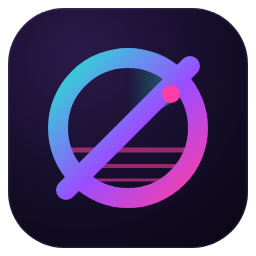
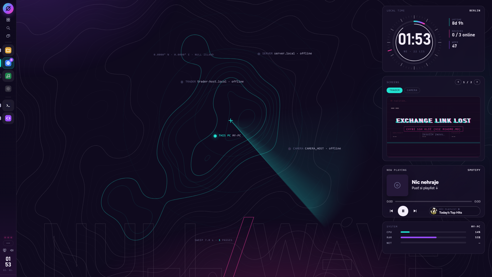
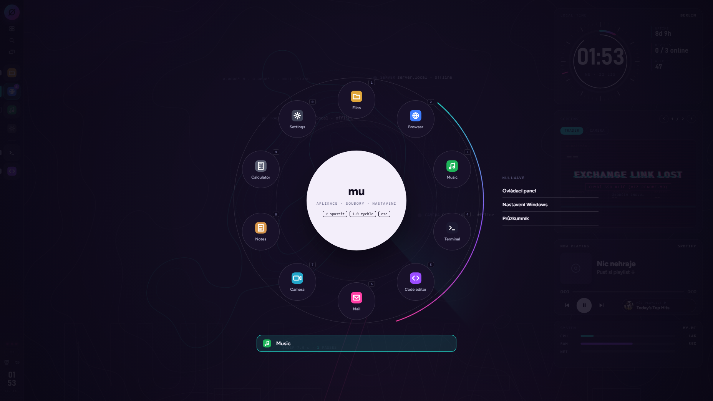
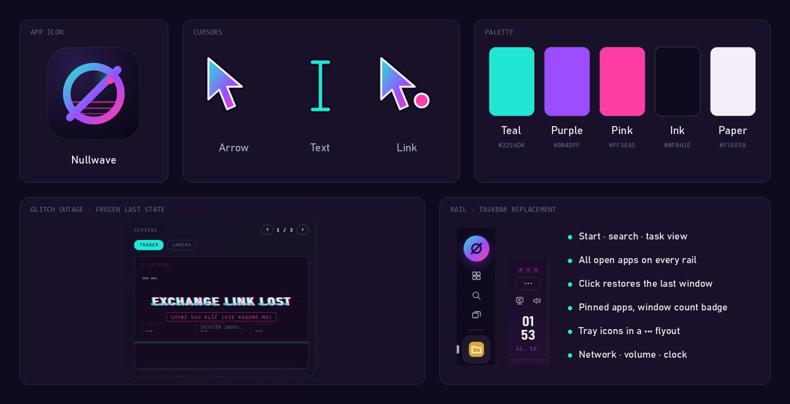

<p align="center"></p>

# Nullwave

An animated live desktop and taskbar replacement for Windows 11, in a teal, purple and pink neon look.



<sub>The rail on the left replaces the Windows taskbar. Sample apps and placeholder hosts are shown.</sub>

Nullwave puts a live wallpaper with widgets behind your desktop icons on every monitor. It replaces the Windows taskbar with a slim rail and switches the Windows look (dark mode, accent colour, cursors) to match. When you quit, everything goes back exactly as it was.

> The UI text is in Czech. Strings sit next to the code in plain HTML/JS, so they are easy to translate.

## Features

- **Animated wallpaper on every monitor.** Topographic contour lines, a radar sweep and a glow, rendered behind the desktop icons (embedded under Explorer's `SHELLDLL_DefView`). Secondary monitors get the background only.
- **Widgets on the primary monitor:**
  - **Clock** with uptime, week number and the online/total count of your devices.
  - **Radar** that pings your own devices (TCP connect) and shows them as blips.
  - **Screens:** a trading-bot dashboard (a JSON state file read over a restricted, read-only SSH key) and an IP camera (RTSP → MJPEG through ffmpeg).
  - **Now playing:** the current Windows media session (Spotify etc.) with cover art and controls.
  - **System:** CPU, RAM and network.
- **Glitch outage overlays.** When the trader host or the camera stops answering, the widget freezes on its last picture and an animated "EXCHANGE LINK LOST" / "SIGNAL LOST" glitch plays over it.
- **Rail (taskbar replacement)** on each monitor's left edge:
  - all open apps on every rail, and clicking one restores its last window
  - Start, search, show desktop and clock
  - network type (LAN / Wi-Fi / offline)
  - notification-area icons through a flyout. A small UI Automation helper, compiled on first use from `shell/tray-helper.cs` with the .NET Framework `csc.exe` that ships with Windows.
- **Launcher:** a radial "start menu" (Alt+Space or the logo on the rail) with search, number keys 1–0 for pinned apps and quick links.

  
- **Windows look switcher** (`theme/theme.ps1`). Dark mode, accent palette, cursors and wallpaper are written to HKCU and to the current theme file. A full backup is taken first and restored on quit.
- **Optional switch-port widget** for TP-Link Easy Smart switches, through the PortTik app. It is off by default (`ports.enabled`) and needs PortTik, which is not part of this repository.
- **Lightweight.** Feeds start only while something is looking at them. Everything pauses when the desktop is covered, and there are `lite` and `static` modes.

## Details



- **Cursors:** custom arrow, text and link cursors in the teal → purple gradient (`theme/cursors`, `.cur` plus SVG sources), switched on and off together with the Windows look.
- **App icon:** the null sign with a scan line, in `brand/` as SVG, PNG and ICO.
- **Palette:** teal `#22E6D4`, purple `#9B4DFF`, pink `#FF3EA5` on ink `#0F0A1E`. The accent colour of Windows (Start, title bars) is set to the same purple.
- **Typography:** Figtree for the UI, Bahnschrift and Consolas from Windows for numbers and labels.

## Requirements

- Windows 11 (tested on 25H2), with mixed-DPI multi-monitor support
- Node.js 20+ and npm
- Optional: `ffmpeg.exe` for the camera, OpenSSH client for the trader feed

## Quick start

```powershell
git clone https://github.com/Danieljsem/nullwave.git
cd nullwave\shell
npm install
npm start
```

On the first start `hub/config.json` is created from `hub/config.example.json` with a random access key. Edit it to point the widgets at your own devices, then quit Nullwave from its tray icon and start it again.

| Key | What it is |
|---|---|
| `devices` | Hosts shown on the radar (`id`, `label`, `host`, `port` for the TCP ping) |
| `trader` | `ssh`, `key` (private key file), `host` (`user@host`) and `everyMs` for the trading dashboard. The remote side should allow that key **only** to print the state JSON, e.g. `restrict,command="cat ~/bot/state.json" ssh-ed25519 …` in `authorized_keys`. |
| `cam85` | `rtsp` URL and `label` of the camera |
| `ffmpeg` | Path to `ffmpeg.exe` |
| `spotifyPlaylist` | Spotify playlist id for the "play my playlist" button |
| `shell.widgets` | `primary` (widgets on the primary monitor) |
| `shell.applyTheme` | Switch the Windows look while Nullwave runs |
| `shell.pins` | Apps pinned to the rail and launcher |
| `ports` | Optional switch widget: `enabled`, `porttikDir`, `vlanColors` (`{"10": "#3fbf7f"}`) |

The hub listens on `127.0.0.1` only, and every request needs the key from `config.json`.

### Trader feed format

The trader screen expects the remote command to print JSON like this (field names come from the bot it was built for):

```json
{
  "status": "obchoduje",
  "equity": 10250.4,
  "start_capital": 10000,
  "recent_equity": [[1732200000, 10000], [1732203600, 10250.4]],
  "open": { "side": "LONG" },
  "trades": [{ "datum": "2026-11-21", "cas": "15:42", "smer": "LONG", "krok": 1, "pnl_usd": 42.5 }]
}
```

`status` containing `obchoduje` ("trading") lights the live dot. `open` is `null` when no position is open. For a quick test without SSH, set `trader.file` to a local JSON file instead.

## If something goes wrong

Run `restore-windows.ps1` (right click → Run with PowerShell). It stops Nullwave, brings back the Windows taskbar and its auto-hide setting, and restores the original Windows look from the backup.

## Project layout

```
shell/      Electron app: monitors, wallpaper embedding, rails, launcher, tray flyout (koffi Win32 FFI)
hub/        Local HTTP hub: feeds for the widgets (ssh, RTSP, media session, pings), control API
wallpaper/  The animated wallpaper and widgets (one HTML file)
panel/      Control panel
theme/      Windows look switcher, cursors, static wallpaper
brand/      Logo and icon
```

## License

MIT. See [LICENSE](LICENSE). The Figtree font is under the SIL Open Font License (`wallpaper/fonts/OFL.txt`).
